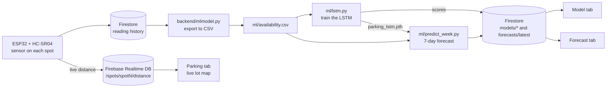

# LotLink

**Parking availability. Anywhere. Anytime.**

LotLink shows which spots in a parking lot are open right now and forecasts how full the lot will be over the next week. Sensors on each spot report to Firebase, the mobile app shows a live map of the lot, and an LSTM neural network trained on past readings predicts availability for the week ahead.

**Team**
- Anish Nair: machine learning pipeline (LSTM training and forecasting) and the Model and Forecast tabs
- Sarvad: app design and UI, sensor hardware
- Ayaan Ihtesham: Firebase setup and sensor data

## The problem

Our local temple's parking lot fills up fast during services and festivals. People arrive, circle the lot looking for a spot, block the lanes, and end up parking on nearby streets or neighborhoods. Nobody can tell from the road whether the lot is full, and nobody knows ahead of time which days and hours are the busiest.

LotLink answers both questions: is there a spot right now, and when should I come if I want one?

## How it works



**Live availability.** Each spot has an HC-SR04 ultrasonic distance sensor wired to an ESP32. The ESP32 sends the distance reading to Firebase Realtime Database, and if something is closer than 30 cm the spot counts as taken. The app subscribes to those values, so the map updates within seconds of a car pulling in or leaving.

**Forecasting.** Readings are also logged to Firestore. `backend/mlmodel.py` exports that history to `ml/availability.csv`. `ml/lstm.py` resamples it into 5-minute buckets and trains a 2-layer LSTM (64 hidden units). The model looks at the last 4 hours (48 buckets) of occupancy plus the time of day and day of the week, and predicts whether each spot will be taken in the next 5 minutes. Time features are encoded as sine/cosine pairs so 11 PM and midnight look close together to the model. Training holds out 20% of the windows and scores the model on them (accuracy, Brier score and cross-entropy), and those scores are published to Firestore for the Model tab.

`ml/predict_week.py` then rolls the model forward one 5-minute step at a time, feeding each prediction back in, for 2,016 steps (7 days). The result goes to Firestore at `forecasts/latest`, which the Forecast tab reads. `ml/run_forecast.sh` runs this on a schedule and refuses to publish if the newest sensor reading is more than 15 minutes old, so a stale forecast never looks fresh.

## The app

| Tab | What it shows |
| --- | --- |
| Home | Landing page with a shortcut to the live map |
| Parking | A map of the temple lot. The sensor-equipped spot turns green when it's free and red when it's taken, live from Firebase. The rest of the lot is drawn to show the full layout and isn't wired to sensors yet, due to money and time constraints. |
| Model | How the forecasting model works, when it was last trained, how well it scored on held-out data, predicted vs actual on recent held-out data, and a warning when sensor data goes stale |
| Forecast | The week-ahead availability forecast, so you can pick a time when the lot is likely to have room |

## Tech stack

- **App:** React Native with Expo and TypeScript, expo-router for tabs, react-native-svg for the lot map
- **Backend:** Firebase Realtime Database (live readings) and Cloud Firestore (history, model scores, forecasts)
- **Machine learning:** Python, PyTorch, pandas, NumPy, pytest
- **Hardware:** ESP32 microcontroller, HC-SR04 ultrasonic sensors

## Repository layout

```
frontend/   Expo app. Screens are in app/, the lot map is components/ParkingLotLayout.tsx,
            Firebase setup is lib/firebase.ts
ml/         LSTM training (lstm.py), weekly forecast (predict_week.py), scheduled runner
            (run_forecast.sh), data loading (ingest.py) and tests (test_*.py)
backend/    Exports the sensor history from Firestore to CSV (mlmodel.py)
```

## Running it

### App

```bash
cd frontend
npm install
npx expo start
```

Press `w` to open it in a browser, or scan the QR code with the Expo Go app on a phone.

### Machine learning

```bash
python3 -m venv venv
source venv/bin/activate
pip install -r ml/requirements.txt
cd ml
python lstm.py
python predict_week.py --dry-run # build the 7-day forecast without writing to Firebase
pytest # run the full testing suite
```

To publish results to Firebase (`python lstm.py --publish`, `python predict_week.py`), put a Firebase service account key at `ml/serviceAccountKey.json`. It's deliberately not committed.

## What's next (if we had more time)

- Put sensors on every spot in the lot and map all of them live
- Notifications when the lot is about to fill up at a time you usually visit
- Camera-based detection for larger lots may be more feasible than a bunch of sensors.
